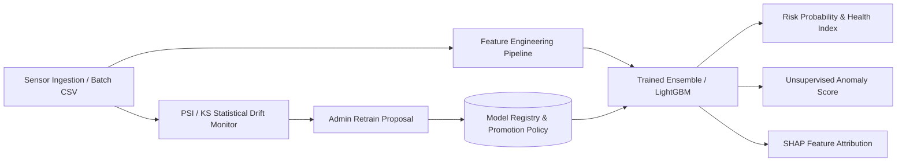

# APEX — Intelligent Predictive Maintenance & MLOps Platform

[](https://github.com/Aasthachauhan/APEX-Intelligent-Predictive-Maintenance-Platform/actions/workflows/ci.yml)
[](https://www.python.org/downloads/release/python-3120/)
[](https://opensource.org/licenses/MIT)

An enterprise-grade, high-throughput Predictive Maintenance & MLOps platform engineered to predict industrial equipment failure, assess degradation risk, isolate anomalous telemetry, explain predictions with SHAP feature attributions, and manage automated model lifecycle governance with strict promotion policies and input drift detection.

---

## Key Capabilities

- **Multi-Model Machine Learning Pipeline**: Trains and benchmarks 5 failure classification models (Logistic Regression, Decision Tree, Random Forest, XGBoost, LightGBM) with class-weight balancing, automated validation PR-AUC selection, and recall-weighted (F2-score) optimal threshold tuning.
- **Physics-Informed Feature Engineering**: Stateless feature transforms for thermal difference ($\Delta T = T_{process} - T_{air}$), mechanical power ($P = \tau \cdot \omega$), mechanical strain ($S = \text{wear} \cdot \tau$), and tool wear rate inside an sklearn pipeline.
- **High-Performance FastAPI Service**:
  - Single telemetry risk scoring with health index computation.
  - High-throughput batch CSV inference engine (>5,000 rows/second).
  - Unsupervised sensor anomaly detection (Isolation Forest, Local Outlier Factor, One-Class SVM).
  - Local tree-based SHAP feature attribution explainability.
- **Enterprise Model Governance & Registry**:
  - Strict model candidate promotion policy (preventing recall or PR-AUC regressions without explicit admin justification).
  - Instant one-click rollback to previously active model version.
  - Cryptographic artifact integrity verification via SHA-256 manifest validation.
- **Production Drift Monitoring**: Real-time Population Stability Index (PSI) and two-sample Kolmogorov-Smirnov (KS) statistical drift evaluation against training reference distributions.
- **Security & RBAC**: JWT authentication (access tokens + revocable refresh tokens), password hashing via bcrypt, role-based access control with admin allowlist, request rate limiting, and immutable audit trails.



---

## Architecture & Tech Stack

- **Framework**: FastAPI, Uvicorn, Pydantic v2
- **Data & Machine Learning**: Scikit-Learn, LightGBM, XGBoost, SHAP, NumPy, Pandas, SciPy
- **Database & Tracking**: SQLAlchemy 2.0, PostgreSQL / SQLite, MLflow
- **Security**: PyJWT, Bcrypt, OAuth2 Password Bearer
- **Testing & Quality**: Pytest, Pytest-Cov (92% test coverage), Ruff, Mypy

---

## Quick Start

### 1. Environment Setup
```bash
# Clone the repository
git clone https://github.com/Aasthachauhan/APEX-Intelligent-Predictive-Maintenance-Platform.git
cd APEX-Intelligent-Predictive-Maintenance-Platform

# Create and activate virtual environment
python -m venv .venv
source .venv/bin/activate  # On Windows: .venv\Scripts\activate

# Install dependencies
pip install -r requirements.txt
```

### 2. Configuration
Copy the sample environment file:
```bash
cp .env.example .env
```
For local development:
```bash
export APEX_ENV=dev
export APEX_ADMIN_EMAILS=admin@example.com
```

### 3. Model Training & Service Startup
```bash
# Train models and generate active artifact
PYTHONPATH=. python -m ml.training.train --mlflow

# Run FastAPI backend server
PYTHONPATH=. uvicorn backend.app.main:app --reload
```
Interactive Swagger documentation is available at `http://127.0.0.1:8000/docs`.

---

## API Endpoints

| Endpoint | Method | Auth | Description |
|---|---|---|---|
| `/auth/register` | POST | Public | Register new user account |
| `/auth/login` | POST | Public | Authenticate and obtain JWT access + refresh tokens |
| `/auth/refresh` | POST | Public | Refresh expired access token |
| `/auth/logout` | POST | Bearer Token | Revoke refresh token |
| `/predict` | POST | Bearer Token | Generate real-time failure probability, risk tier & health index |
| `/predict/batch` | POST | Bearer Token | Batch inference on uploaded CSV file |
| `/explain` | POST | Bearer Token | Compute top SHAP feature contributions |
| `/anomaly` | POST | Bearer Token | Calculate unsupervised sensor anomaly score |
| `/model/info` | GET | Bearer Token | Retrieve active model metadata, metrics, and SHA-256 |
| `/predictions` | GET | Bearer Token | Query authenticated user's prediction audit history |
| `/monitoring/drift` | POST | Bearer Token | Run PSI / KS input drift analysis on incoming telemetry |
| `/admin/models` | GET | Admin | List all registered model versions and statuses |
| `/admin/retrain` | POST | Admin | Retrain model candidate on uploaded dataset |
| `/admin/models/{v}/promote` | POST | Admin | Promote candidate model to active |
| `/admin/models/rollback` | POST | Admin | Roll back active model to previous version |

---

## Running with Docker

```bash
docker compose up --build -d
```

---

## Quality & Testing

```bash
make lint     # Ruff linting & formatting checks
make test     # Pytest suite with code coverage (43 tests, 92% coverage)
make smoke    # Full clean-start end-to-end smoke test
```

---

## Author
**Aastha Chauhan**  
GitHub: [@Aasthachauhan](https://github.com/Aasthachauhan)
